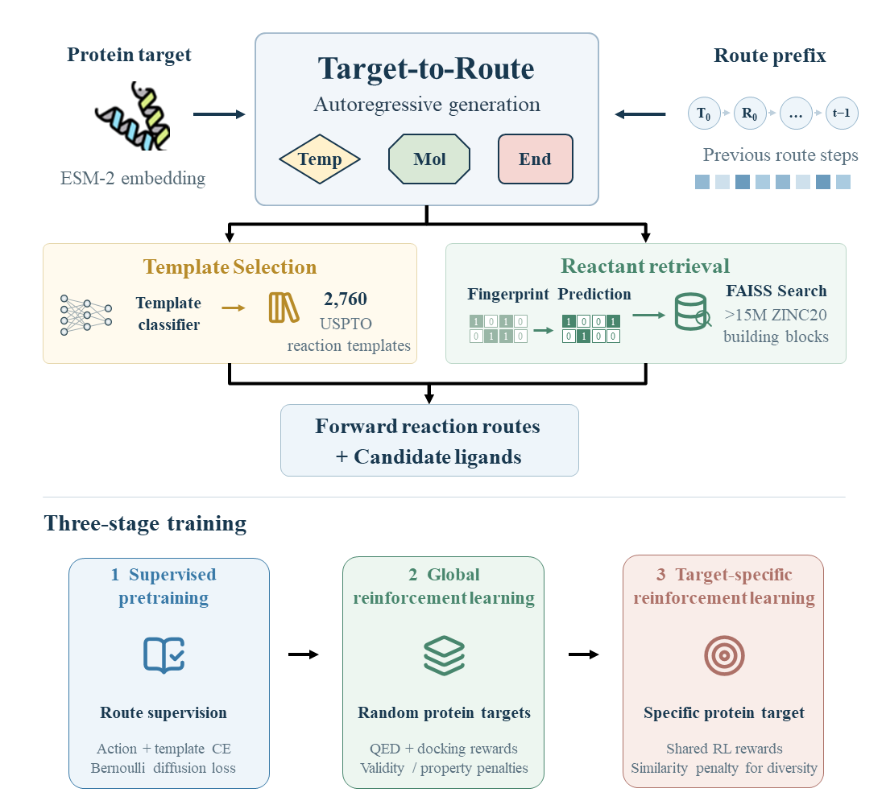

# Target-to-Route: De Novo Ligand Design Conditioned on Targets through Direct Synthetic Route Generation



[Data and checkpoints](#data-and-checkpoints) · [Checkpoint verification](#checkpoint-verification) · [Training and evaluation](#training-and-evaluation) · [Single-target generation](#single-target-generation)

## Data and checkpoints

Download the complete `data/` and `checkpoints/` directories and place both in the repository root, alongside `run.py`. [Target2Route on Hugging Face](https://huggingface.co/CROWD-lpy/Target2Route)

Run the commands below from the repository root.

## Checkpoint verification

### Supervised checkpoint

```bash
python run.py check-checkpoint \
  --config configs/supervised.yaml \
  --checkpoint checkpoints/supervised/model.pt
```

### Global reinforcement learning checkpoint

```bash
python run.py check-checkpoint \
  --config configs/rl_global.yaml \
  --checkpoint checkpoints/global/model.pt
```

### Target-specific checkpoints

```bash
python run.py check-checkpoint \
  --config configs/rl_target.yaml \
  --checkpoint checkpoints/target/HPK1/model.pt

python run.py check-checkpoint \
  --config configs/rl_target.yaml \
  --checkpoint checkpoints/target/RIPK1/model.pt

python run.py check-checkpoint \
  --config configs/rl_target.yaml \
  --checkpoint checkpoints/target/LRRK2/model.pt
```

## Training and evaluation

### Supervised pretraining

Add `--max-batches 200` for a short run of up to 200 batches per data pass.

```bash
python run.py train-sl \
  --config configs/supervised.yaml \
  --device cuda:0 --batch-size 64 --epochs 30 --seed 2026
```

### Resume supervised training

Replace `xxxx` in the paths with your run directory and checkpoint filename. Set `--epochs` to the total number of epochs to reach. Add `--max-batches 300` to cap each data pass at 300 batches.

```bash
python run.py train-sl \
  --model-config runs/supervised/xxxx/config.yaml \
  --resume runs/supervised/xxxx/ckpt/xxxx.pt \
  --epochs 40 --device cuda:0
```

### Evaluate the supervised checkpoint

```bash
python run.py evaluate-sl \
  --config configs/supervised.yaml \
  --checkpoint checkpoints/supervised/model.pt \
  --split test --device cuda:0 --batch-size 32 --max-batches 50 --seed 2026
```

### Global reinforcement learning

```bash
python run.py train-global \
  --config configs/rl_global.yaml \
  --checkpoint checkpoints/supervised/model.pt \
  --device cuda:0 --batch-size 64 --episodes 4000 --docking-workers 16 --seed 2026
```

### Target-specific fine-tuning

Supply the target's amino acid sequence with `--sequence` or its single-record FASTA file with `--fasta`. Replace `xxx.pdbqt` with the prepared receptor file and `a b c` with three numeric coordinates for the docking box center in Å.

#### From a protein sequence

```bash
python run.py train-target \
  --config configs/rl_target.yaml \
  --checkpoint checkpoints/global/model.pt \
  --sequence xxx --receptor xxx.pdbqt --box a b c \
  --device cuda:0 --esm2-device cuda:0 \
  --batch-size 64 --episodes 1000 --docking-workers 16 --seed 2026
```

#### From a FASTA file

```bash
python run.py train-target \
  --config configs/rl_target.yaml \
  --checkpoint checkpoints/global/model.pt \
  --fasta xxx.fasta --receptor xxx.pdbqt --box a b c \
  --device cuda:0 --esm2-device cuda:0 \
  --batch-size 64 --episodes 1000 --docking-workers 16 --seed 2026
```

## Single-target generation

Use the checkpoint for your target. Replace the sequence, FASTA, and docking placeholders with your inputs. Choose a new `--output-dir` for each run.

### From a protein sequence

#### Without docking

```bash
python run.py generate \
  --config configs/rl_target.yaml \
  --checkpoint checkpoints/target/xxx/model.pt \
  --sequence xxx --no-docking \
  --num-mols 100 --batch-size 64 --max-batches 100 \
  --device cuda:0 --esm2-device cuda:0 --seed 2026 \
  --output-dir runs/generation/xxx
```

#### With docking

```bash
python run.py generate \
  --config configs/rl_target.yaml \
  --checkpoint checkpoints/target/xxx/model.pt \
  --sequence xxx --receptor xxx.pdbqt --box a b c \
  --num-mols 20 --batch-size 64 --max-batches 100 \
  --device cuda:0 --esm2-device cuda:0 --seed 2026 \
  --output-dir runs/generation/xxx
```

### From a FASTA file

#### Without docking

```bash
python run.py generate \
  --config configs/rl_target.yaml \
  --checkpoint checkpoints/target/xxx/model.pt \
  --fasta xxx.fasta --no-docking \
  --num-mols 20 --batch-size 64 --max-batches 100 \
  --device cuda:0 --esm2-device cuda:0 --seed 2026 \
  --output-dir runs/generation/xxx
```

#### With docking

```bash
python run.py generate \
  --config configs/rl_target.yaml \
  --checkpoint checkpoints/target/xxx/model.pt \
  --fasta xxx.fasta --receptor xxx.pdbqt --box a b c \
  --num-mols 20 --batch-size 64 --max-batches 100 \
  --device cuda:0 --esm2-device cuda:0 --seed 2026 \
  --output-dir runs/generation/xxx
```
